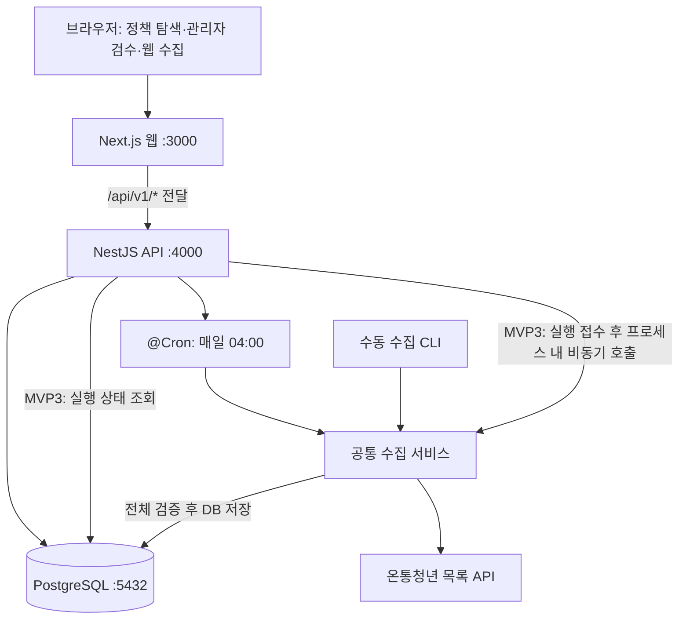
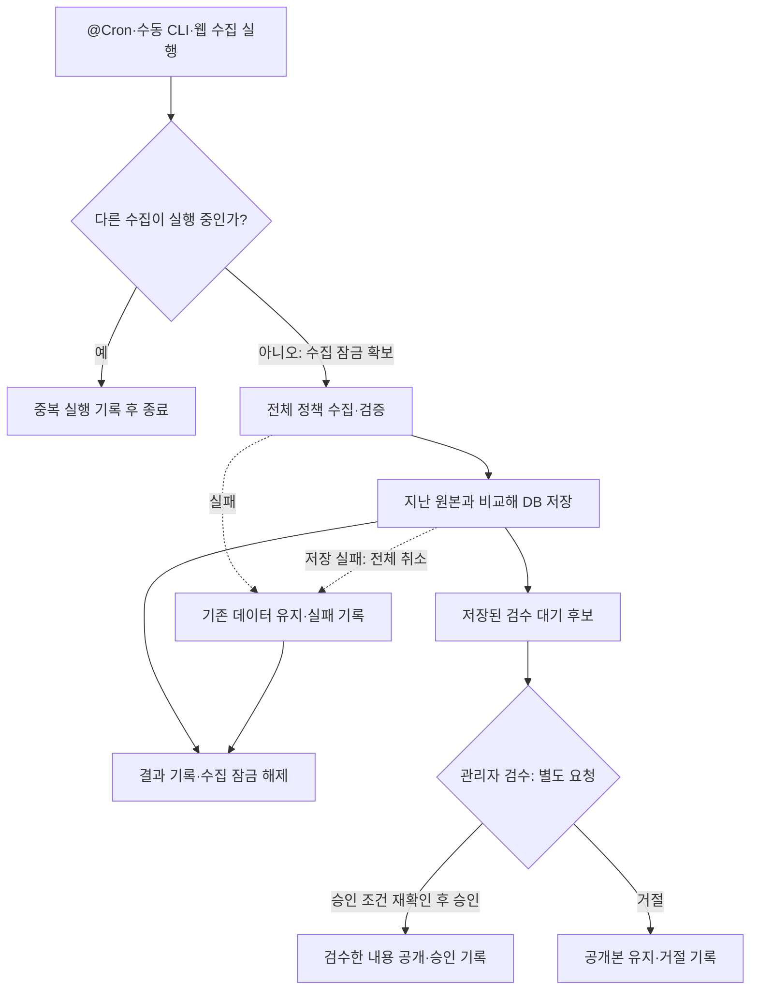

# 청년꿀통(youth-kkultong) ARCHITECTURE v0.9

기준: PRD v0.14 (2026-11-07), 상태: MVP1과 MVP2 구현 기반, MVP3 구조 방향 확정(구현 전)

이 문서는 실행 구조·모듈 경계·데이터 흐름을 정의한다. 제품 정책은 PRD, 기존 구현 세부 기준은 `mvp-1/`·`mvp-2/`의 SPEC을 따른다. 실제 구현과 검증 기록은 각 MVP의 SUMMARY에서 관리한다. 아래 MVP3 확장 방향은 이후 `mvp-3/SPEC.md`에서 구체화하며 아직 구현된 기능이 아니다.

## 목차

1. [설계 목표](#1-설계-목표)
2. [기술 스택](#2-기술-스택)
3. [시스템 구성](#3-시스템-구성)
4. [서비스 내부 구조](#4-서비스-내부-구조)
5. [데이터 흐름](#5-데이터-흐름)
6. [저장소·디렉터리 구성](#6-저장소디렉터리-구성)
7. [실행·배포와 보안](#7-실행배포와-보안)
8. [검증 기준과 설계 결정](#8-검증-기준과-설계-결정)

## 1. 설계 목표

온통청년 정책을 안정적으로 수집·보관하고, 사용자가 입력한 조건에 따라 **명확한 부적합만 제외한 뒤 지역 관련 여부와 확인된 일치 점수로 맞춤 정렬**한다.

- MVP1에서 검증한 수천 건 규모의 **단일 API 서버** 구조를 유지한다.
- 수집, DB 저장, 정책 조회, 자격 판단, 정렬을 역할별로 구분한다.
- 최신 수집 원본·검수 후보·공개 정책을 분리하고 승인된 내용만 사용자에게 제공한다.
- 기존 UUID·공개 API·조회 계산과 MVP2 자동 수집·관리자 웹 검수를 유지한다.
- MVP3는 기존 모듈 안에서 중요도 기반 탐색·일괄 검수·웹 수집과 실행 상태 조회를 확장한다.
- 이용자 조건은 요청 시에만 처리하고, DB에는 정책·검수 운영 데이터와 공식 지역 코드를 저장한다.

## 2. 기술 스택

| 구분 | 선택 | 용도 |
| --- | --- | --- |
| 언어·실행 | TypeScript(strict), Node.js 24 LTS | 웹·서버 공통 언어 |
| 프런트엔드 | Next.js (App Router), React | 정책 목록·필터·상세 및 관리자 검수·수집 운영 UI |
| 백엔드 | NestJS (REST API) | 수집·정책 조회·매칭·정렬·검수·관리자 인증 |
| DB | PostgreSQL 17 | 수집 원본(JSONB)·검수 후보/이력·공개 정책·공식 지역 코드·MVP3 실행 요약 |
| DB 접근 | TypeORM + Migration(스키마 변경 파일) | 엔티티·조회·DB 변경 이력 |
| 데이터 검증 | Zod | API 요청 및 공통 타입 검증 |
| 실행 | Docker Compose + `@nestjs/schedule` | web·api·db 관리, NestJS `@Cron` 자동 수집 |
| 테스트 | Jest, Supertest | 규칙 단위 테스트 및 API 통합 테스트 |
| 로그·실행 기록 | NestJS Logger + 수집 전용 파일 로그, PostgreSQL 실행 요약(MVP3) | 상세 진단 로그와 웹 상태 조회용 영속 기록을 분리 |

버전의 세부 패치 번호는 구현 시점에 호환성을 확인하고 잠금 파일(`package-lock.json`)과 Docker 이미지 태그로 고정한다. 패키지 관리는 **npm workspaces(작업공간)** 를 사용한다.

## 3. 시스템 구성



- `web`: 기존 정책 탐색·관리자 검수 화면에 MVP3 목록 개선·일괄 검수·수집 실행 및 최소 운영 상태 표시를 추가한다.
- `api`: 기존 공개·관리자 API에 MVP3 일괄 검수와 수집 실행·상태 조회 API를 추가한다. CLI는 같은 NestJS 모듈·소스·이미지를 재사용한다.
- `db`: 수집 원본, 검수 후보와 이력, 공개 정책, 공식 지역 코드 및 수집 잠금을 관리한다. MVP3에서 웹 조회용 최소 실행 요약을 보관한다.
- **자동·수동 실행:** `@Cron`·수동 CLI·MVP3 웹 요청은 같은 수집 서비스를 사용한다. 웹 수집은 실행 접수와 HTTP 응답을 마친 뒤 기존 API 프로세스 안에서 비동기로 계속한다. CLI는 독립 프로세스로 실행하고 종료한다. Redis·BullMQ·별도 Worker나 CLI 자식 프로세스를 추가하지 않는다.
- `ScheduleModule.forRoot()`와 스케줄러 제공자는 HTTP 실행 구성에만 등록한다. 수집·Migration·시드 CLI에는 스케줄러를 등록하지 않는다. 단일 API 인스턴스를 기준으로 하며 자동·수동 수집은 같은 DB 잠금을 사용한다.
- 브라우저의 `/api/v1/*` 요청은 기존 Next.js `rewrites(경로 전달)`로 내부 `api:4000`에 연결한다. 관리자 요청도 같은 경로를 사용하며, 권한 확인은 API에서 수행한다.

컨트롤러는 요청·응답과 접근 검사를, 서비스는 업무 흐름을, Repository(저장소 계층)는 DB 접근을 맡는다. 매칭·신청 상태 계산은 DB 호출 없는 순수 함수로 유지한다.

## 4. 서비스 내부 구조

### 4.1 NestJS 모듈

| 모듈 | 핵심 역할 |
| --- | --- |
| `PoliciesModule` | 기존 공개·원본·검수 데이터와 업무 서비스. MVP3 중요도 계산·전체 후보 필터/정렬·일괄 검수 조정 추가 |
| 매칭 순수 함수 (`modules/matching/`) | 나이·취업·학력 제외 판단, 지역 관련 점수, 맞춤 정렬. 별도 NestJS 모듈 클래스 없이 정책 서비스에서 사용 |
| `IngestionModule` | 공통 수집·검증·변환·잠금·로그와 수집분 저장 요청. HTTP 전용 스케줄 구성과 CLI에서 재사용하며 MVP3 실행 관리·상태 조회 추가 |
| `AdminModule` | 기존 인증·권한 검사·검수 API에 MVP3 일괄 검수·웹 수집·실행 상태 조회 API 추가. 업무는 Policies·Ingestion 서비스에 위임 |
| `MetaModule` | DB의 지역 목록(`RegionRepository`)·정책 분야 목록, 서버에 정의한 취업·학력 코드표 제공 |
| `DatabaseModule` | 공통 TypeORM 연결 설정·Migration·지역 시드 실행 기반 |

`IngestionModule`과 `AdminModule`은 각각 `PoliciesModule`의 저장·검수 서비스를 호출한다. 정책 모듈 안에서 **원본 저장·검수·공개 쓰기**를 역할별 서비스로 나누고 관련 엔티티·Repository를 관리한다. MVP3에서는 `AdminModule`이 `IngestionModule`의 실행·조회 서비스도 호출하도록 단방향 의존을 추가한다. Ingestion·Policies는 Admin에 의존하지 않으며 관리자 컨트롤러에서 직접 DB를 바꾸지 않는다. 실행 요약의 엔티티·Repository와 재시작 후 상태 확인은 Ingestion이 소유한다.

`MetaModule`의 분야 목록은 `PoliciesModule`이 내보내는 `PolicyRepository`를 이용한다. 정책 검색 서비스는 `MetaModule`이 내보내는 `RegionRepository`로 현행 코드와 부모 관계를 한 번 조회해 요청 검증·지역 판정에 재사용한다. 두 모듈의 상호 참조는 NestJS `forwardRef`(지연 참조)로 연결하며 Repository를 중복 등록하지 않는다. `DatabaseModule`은 DB 연결과 Migration 중심으로 유지한다.

매칭 함수는 정규화된 정책과 사용자 조건을 받아 제외 여부·점수·태그를 반환한다.

### 4.2 Next.js 페이지

| 경로 | 화면 |
| --- | --- |
| `/` | `/policies`로 이동(리다이렉트) |
| `/policies` | 정책 목록, 분야·조건 입력, 정렬, 마감 포함, 페이지네이션 |
| `/policies/[id]` | 정책 상세, 지원 내용·기간·자격 조건, 신청·참고 링크 |
| 관리자 전용 영역 | 기존 인증·검수·이력·누락 화면에 MVP3 목록 개선·일괄 검수 확인 모달·항목별 결과·수집 운영 화면 추가. 기존 경로는 MVP2 SPEC 8장, 추가 경로는 MVP3 SPEC에서 정의 |

필터는 Client Component(브라우저 동작 컴포넌트)로 구현한다. 공개 탐색의 `sessionStorage`(탭 세션 저장소) 범위는 MVP1 SPEC 8.1절을 유지한다. 사용자 조건은 검색 POST 본문으로만 보내고 서버에 저장하지 않는다. 관리자 인증은 HttpOnly 쿠키를 사용하며 화면 접근 제어와 별개로 API에서 권한을 검사한다.

MVP3 검수 대기 목록의 탭 세션 저장 범위는 PRD 3.3절을 따른다. 저장값 검증과 필터 조합 복원은 MVP3 SPEC에서 정의한다. 체크박스 선택은 페이지, 필터, 정렬 또는 표시 개수가 바뀌면 초기화한다. 수집 상태는 서버 조회로 복원한다.

### 4.3 MVP3 중요도 계산과 목록 조회

- `PoliciesModule`의 `rules/reviews/`에 중요도 판정 순수 함수를 둔다. 기존 `calculatePolicyFieldDiff`로 후보의 `base_raw_snapshot`과 `raw_snapshot`을 비교해 변경된 온통청년 API 원본 필드를 구한다. `policies`의 변환 컬럼은 일부 원본 필드와 변경 정보를 담지 못하므로, 검수 당시 원본 스냅샷을 계산 기준으로 사용한다.
- 목록과 상세는 같은 서버 판정 함수를 사용한다. 분류 정책은 PRD 3.2절, 전체 원본 필드 매핑은 MVP3 SPEC을 따른다. 기존 조회수 제외 규칙, 내용 해시와 후보 생성 로직을 재사용한다.
- `PolicyReviewsReadService`와 `PolicyReviewRepository`를 확장해 **전체 대기 후보 → 필드 차이와 중요도 계산 → 검색, 유형, 중요도 필터 → 정렬 → 총 건수와 페이지 산출** 순서로 처리한다. 필요한 스냅샷을 일괄 조회해 서버에서 계산한다.
- 정렬은 PRD 3.3절을 따르며, 후보 생성 시각까지 같으면 **후보 ID 오름차순**으로 순서를 고정한다. 필터 조합과 정확한 다중 정렬 규칙은 이 기준에 따라 MVP3 SPEC에 명시한다.

### 4.4 MVP3 일괄 검수 처리

`PoliciesModule`의 검수 서비스에 일괄 요청을 조정하는 흐름을 추가하고 기존 `PolicyReviewApprovalService`·`PolicyReviewRejectionService`를 후보별로 호출한다. 컨트롤러에서 처리 규칙을 복제하거나 후보 상태를 묶음 UPDATE하지 않는다.

- 목록에서 확인한 후보 ID와 변경본·기준본 해시를 후보별로 전달한다. 선택 상한과 입력·중복 ID 검증은 서버에서도 수행한다.
- 후보를 하나씩 독립 트랜잭션으로 처리하며 기존 **원본→후보→공개본** 잠금, 해시·대기 상태 재확인, 승인 시 공개 저장과 이력의 원자성을 유지한다. 일괄 전체를 하나의 트랜잭션으로 감싸지 않는다.
- 각 후보의 오류를 수집하고 다음 후보를 계속 처리한다. 성공한 후보는 유지하며 공통 거절 사유도 기존 서비스가 후보별 `rejection_reason`에 저장한다.
- 기존 종료 후보 재처리 거부와 해시 검증으로 중복 요청·오래된 화면을 방어한다. 화면은 항목별 성공·충돌·실패와 안전한 원인을 표시하고, 응답 유실 시 후보 상세·이력 재조회로 최종 상태를 확인한다. 확인 불가를 확정 실패로 바꾸거나 일괄 POST를 자동 반복하지 않는다.

별도 일괄 작업 큐·이력 테이블 없이 기존 후보별 처리 이력을 우선 재사용한다. 요청 식별·중복 요청 응답·결과 재확인의 구체적인 계약과 부분 응답 오류는 MVP3 SPEC에서 정의한다. 기존 JSON 본문 한도 16KB와 후보 100건의 ID·두 해시 전송량, 처리 시간·프록시 제한을 함께 검토해 요청 형식과 한도를 정한다. 공개·인증 등 다른 경로의 제한을 일괄 완화하지 않는다.

## 5. 데이터 흐름

### 5.1 수집 → 비교·검수 → 공개



1. **실행:** `@Cron`·CLI·MVP3 웹 수집이 같은 수집 서비스와 PostgreSQL Advisory Lock을 사용한다. 이는 같은 수집 작업의 동시 실행을 막는 잠금이며 DB 전체 잠금이 아니다. 웹 접수·조회와 영속 실행 기록은 5.4절을 따른다.
2. **수집:** 전체 페이지를 메모리에 모아 검증·변환하고 내용 해시(내용 비교값)를 계산한다. API 호출 중에는 DB 트랜잭션을 열지 않는다.
3. **DB 저장:** 지난 원본과 비교해 최신 원본·누락 정보·검수 후보·공개 조회수를 함께 저장한다. 기존처럼 묶음 쿼리를 사용하되 전체 수집분을 하나의 트랜잭션으로 처리한다. **전부 성공하면 저장하고 하나라도 실패하면 전부 취소한다.**
4. **검수:** 관리자는 저장된 후보를 별도 요청으로 승인·거절한다. 후보와 최신 원본, 검수 당시와 현재 공개본을 재확인하고 승인 내용·이력을 한 트랜잭션으로 반영한다.
5. **동시 처리:** 수집 중복 잠금과 별개로 수집 저장·관리자 검수가 같은 정책 행의 잠금 규칙을 공유한다. 확인과 저장 사이에 다른 쓰기가 끼어들지 않게 하며 공개 조회는 계속 제공한다.
6. **종료:** 결과·오류를 기록하고 잠금·연결을 반환한다. DB 확정 후 로그 기록 실패는 저장 취소와 구분한다. 파일 로그 실패도 자원 정리를 막지 않아야 한다.

후보 중복·교체·과거 해시 복귀는 MVP2 SPEC 6장, 호출·누락·재시도·로그는 5장에 정의한다.

### 5.2 탐색 → 맞춤 목록

**검색 순서:** 후보 조회 → 한국 날짜 기준 신청 상태 → 분야·제목·마감 필터 → 부적합 제외·점수·태그 → 전체 정렬 → 페이지 분리.

공개 API는 **`policies`만을 정책 데이터 기준으로 사용**하며, 검수 대기·거절·최신 원본을 직접 조회해 섞지 않는다. 분야 메타 목록도 공개 정책에서 산출한다. 기존 `POST /api/v1/policies/search`, `GET /api/v1/policies/:id`, 메타·health API의 경로와 요청·응답 계약은 유지한다.

현재 규모에서는 API가 **목록 판단에 필요한 경량 컬럼만 조회**하고, 조회한 전체 후보에 상태 계산과 분야·제목·마감 필터를 적용한다. 제목 비교는 서버 JS 순수 함수가 담당하며, 이후 자격 매칭·정렬을 적용한 다음 페이지를 나눈다. 분야의 쉼표 분리·중복 제거는 shared 공용 순수 함수를 API 선택지·JS 필터·웹 표시·세션 복원에서 공유하며 DB 원문은 유지한다. 원본 JSON과 긴 상세 본문은 상세 조회에서 가져온다. 데이터 규모가 크게 증가하면 해당 계산 중 병목 구간만 DB 조회로 이동한다.

### 5.3 DB의 책임

MVP2까지 구현한 `policies`·`regions`·`source_policies`·`policy_reviews`를 유지한다. 원본과 공개 정책은 출처 정책 하나당 각각 최대 한 행으로 대응하며, 식별에는 기존 `(source, external_id)`(출처·외부 ID)를 사용한다. 기존 상세 컬럼·관계 제약·인덱스는 MVP2 SPEC을 따른다. MVP3에서는 아래 최소 실행 요약만 추가하며 컬럼·제약은 MVP3 SPEC에서 정의한다.

| 테이블 | 책임과 관계 |
| --- | --- |
| `source_policies` | 정책별 최신 수집 원본·해시·수집 시각·누락 정보. 하나의 원본에 여러 검수 이력이 연결되고, 공개 정책은 미승인 신규라면 없을 수 있다. |
| `policy_reviews` | 해당 원본의 검수 변경본·공개 기준본 스냅샷, 대상 해시·`base_content_hash`, 검수 결과와 처리 이력. 최신 원본을 덮어써도 당시 내용은 보존한다. |
| `policies` | 승인된 공개 내용·해시·원본 스냅샷과 최신 조회수. 공개 후에는 동일 정책의 UUID를 계속 사용한다. |
| `regions` | 기존 공식 지역 코드, 현행·폐지 구분, 부모·자식 관계 유지. |
| 수집 실행 요약 (MVP3, `ingestion_runs` 가칭) | 실행 ID별 접수·실행·종료와 DB 반영 여부, 확정 집계·안전한 실패 요약 등 웹 조회에 필요한 최소 정보. Ingestion이 관리하며 상세 이벤트 로그와 정책 원문은 복제하지 않는다. |

- 공개 `raw_json`·내용 해시는 승인된 내용이며 최신 조회수는 별도로 갱신한다. 미승인 원본으로 공개본을 덮어쓰지 않는다.
- MVP2 이관에서 기존 공개 데이터를 초기 원본으로 복사했으며 공개 UUID·내용을 유지했다. 대기 후보·가상의 승인 이력은 만들지 않았다. MVP3에서 이 이관을 반복하지 않는다. 이관과 실제 수집 시각의 구분은 MVP2 SPEC 2.4절을 따른다.
- MVP2는 실행 ID·시각·단계·집계·`saved`·`commitOutcome`을 `/app/logs/policies-import.jsonl`과 영구 볼륨에 기록한다. 파일 실패 시 Logger로 대체하며 웹 조회용 저장소나 프로세스 재시작 후 상태 조정 기능은 없다.
- MVP3는 이 로그를 상세 진단용으로 유지하고 **최소 실행 요약 테이블 한 개**를 추가한다. 파일만으로는 대체 로그 누락, 종료 기록 없는 실행과 현재 잠금 보유자의 구분, DB 확정과 결과 기록 사이의 불일치를 안정적으로 처리하기 어렵다. 정책 원본·검수 테이블에 실행 이력을 섞거나 별도 이벤트·진행률 테이블을 추가하지 않는다.

### 5.4 MVP3 웹 수집 실행과 상태 조회

**흐름:** 관리자 실행 요청 → 인증·Origin·입력 검사 → 공통 수집 잠금과 실행 접수 기록 확보 → 실행 ID 응답 → API 프로세스 내 수집 계속 → 실행 ID로 상태 반복 조회. 별도로 현재 실행·마지막 실행·마지막 정상 수집을 조회해 화면 재진입 시 복원한다.

- `IngestionModule`이 실행 접수·상태 조회와 공통 수집 수명 주기를 관리한다. 기존 서비스 내부에서 생성하는 `runId`를 접수 응답·DB 요약·파일 로그에 일관되게 연결하도록 확장한다. Cron·CLI도 같은 기록 흐름을 거친다.
- 중복 방지의 최종 기준은 기존 세션 Advisory Lock이다. 접수와 실제 작업 사이에도 중복 실행 틈이 없도록 잠금 소유권을 유지한다. 실행 기록이 오래 `실행 중`이라는 이유만으로 실제 잠금 상태를 대신 판단하지 않는다. 다른 수집이 있으면 새 작업을 예약하지 않고 현재 실행을 안내한다. 중복 시도 기록은 마지막 실제 실행·정상 수집 결과를 덮어쓰지 않는다.
- 접수 기록을 영속화한 뒤 응답한다. 영속화할 수 없으면 접수 성공으로 안내하지 않는다. 응답이나 브라우저 연결이 끊겨도 이미 접수된 작업은 독립적으로 계속하며, 다시 접속한 화면은 서버의 현재 실행 조회로 확인한다.
- 실행 요약의 DB 반영 증거·확정 집계는 기존 전체 수집 저장 트랜잭션과 함께 확정할 수 있도록 저장 경계를 연결한다. Ingestion이 소유한 기록 로직을 같은 트랜잭션에서 호출할 연결 방식은 SPEC에서 정하며, Policies에서 Ingestion 모듈을 역참조하지 않는다. 실행 종료·로그·잠금 정리는 반영 여부와 별도로 기록한다.
- API 재시작 시 영속 기록과 실제 잠금 상태·DB 반영 증거를 대조한다. 종료 기록이 없다는 이유만으로 계속 실행 중 또는 실패·미반영으로 확정하지 않는다. API 밖에서 계속 실행 중인 CLI도 구분해야 한다. 결과를 입증하지 못하면 확인 불가로 안내하며 자동 재개·재실행하지 않는다.
- 기존 `COMMITTED / NOT_COMMITTED / UNKNOWN` 의미를 재사용해 수집 실행 결과와 DB 반영 여부를 분리한다. DB 반영 후 로그·정리 실패는 반영 완료와 함께 안내하며, 확인 불가 집계를 0건으로 표시하지 않는다. 마지막 정상 수집 시각은 실행 요약에서 별도로 조회하고 단순한 최신 원본 시각으로 추정하지 않는다.

재시작 전 실행을 포함한 조회·상태 조정의 시점과 판정, 마지막 정상 수집의 정확한 기준, 기존 로그의 초기 표시·이관 범위, 기록 보관 정책은 MVP3 SPEC에서 정한다. 실행 상태 전이·API 계약·동시성 예외·폴링 주기도 SPEC의 책임이다. 이 구조는 작업을 내구성 있게 자동 재개하는 큐가 아니며 수집 취소·강제 롤백 기능을 제공하지 않는다.

## 6. 저장소·디렉터리 구성

모듈별 책임을 유지하고 역할별로 배치한다. 같은 역할 안에서 여러 업무를 다루면 함께 읽고 수정하는 업무별 하위 폴더로 묶는다. 아래 API 내부 분류는 2026-11-04 사용자 승인으로 반영한 기준이다.

| 위치 | 역할 |
| --- | --- |
| `apps/web/app/policies/` | 기존 정책 목록·상세·탐색 상태 |
| `apps/web/app/admin/` | 관리자 인증·검수·이력·누락 및 MVP3 수집 운영 화면. 관련 컴포넌트는 기존 정책 화면처럼 같은 폴더에 배치 |
| `apps/api/src/modules/policies/` | 공개·원본·검수 엔티티와 Repository, 조회·저장·검수 서비스 |
| `apps/api/src/modules/ingestion/` | 공통 수집·잠금·로그와 MVP3 실행 관리·조회. 실행 요약 엔티티·Repository도 이 모듈에 소유 역할별로 배치 |
| `apps/api/src/modules/admin/` | 관리자 모듈. `controllers/`는 HTTP 처리, `services/`는 자격 및 쿠키 처리, `guards/`는 권한과 출처 검사 |
| `apps/api/src/modules/matching/`, `meta/` | 기존 매칭·메타 정보 |
| `apps/api/src/database/`, `common/` | 연결·Migration·시드, 설정·오류·로깅 |
| `apps/api/src/cli/` | HTTP 서버 없이 실행하는 수동 수집과 관리자 비밀번호 해시 준비 진입점 |
| `packages/shared/` | API 계약·Zod 스키마·공용 함수 |
| `docs/mvp-1/`, `docs/mvp-2/` | 기존 MVP별 SPEC·PLAN·구현 결과. MVP3 SPEC·PLAN은 이후 `docs/mvp-3/`에 작성 |

**공용 타입에는 API 요청·응답 형식만 둔다.** DB 엔티티는 소속 NestJS 모듈에 둔다. 취업·학력 코드의 실제 값·표시명은 서버에서 관리하고 `MetaModule`을 통해 제공한다. 공용 인터페이스는 이 메타 API의 응답 형식을 정의한다.

`meta`·`policies`의 Controller·Repository·Service는 소속 모듈 안의 `controllers/`·`repositories/`·`services/`에 역할별로 둔다. 모듈 등록 파일은 모듈 루트에 유지하고, 해당 역할의 파일이 아직 없으면 빈 폴더는 만들지 않는다.

Policies는 다음 기준으로 분류한다. 기존 파일명과 클래스 및 함수 이름은 유지한다.

```text
modules/policies/
├─ policies.module.ts
├─ controllers/
├─ entities/
├─ repositories/
├─ services/
│  ├─ public/       # 공개 검색과 상세 조회
│  ├─ collection/   # 수집 원본 반영과 누락 조회
│  └─ reviews/      # 후보 저장, 검수 조회, 승인과 거절
├─ rules/
│  ├─ public/       # 신청 상태, 제목 검색, 검색 후보 판정
│  ├─ collection/   # 수집 결과와 누락 판정
│  └─ reviews/      # 필드 차이, 후보 조정, 검수 충돌 및 MVP3 중요도 판정
├─ responses/       # 공개 카드와 검색 응답 조립
└─ types/           # 수집과 승인이 함께 쓰는 PolicyWriteInput
```

- `services/public/`: `policies-search.service.ts`, `policies-detail.service.ts`.
- `services/collection/`: `policy-collection-write.service.ts`, `missing-policies-read.service.ts`.
- `services/reviews/`: `policy-reviews-read.service.ts`, `policy-reviews-write.service.ts`, `policy-review-approval.service.ts`, `policy-review-rejection.service.ts`.
- `rules/public/`: `application-status.ts`, `title-search.ts`, `policy-search-candidates.ts`.
- `rules/collection/`: `policy-collection.ts`.
- `rules/reviews/`: `policy-field-diff.ts`, `policy-review-decision.ts`, `policy-review-eligibility.ts`.
- `responses/`: `policy-card.ts`, `policy-search-response.ts`.
- `types/`: `policy-write.types.ts`.

Matching의 `checks/`에는 `age-match.ts`, `job-match.ts`, `school-match.ts`, `region-match.ts`를 두고, 종합 판정 `evaluate-policy.ts`와 정렬 `sort-policies.ts`는 Matching 루트에 둔다. 별도 NestJS 모듈은 추가하지 않는다.

Admin은 `controllers/`, `services/`, `guards/`를 유지한다. Ingestion은 공통 `services/`와 출처별 `youth-center/`를 유지한다. Meta, Common, Database는 현재 역할 구분을 유지한다.

`cli/`에는 `import-policies.ts`와 `prepare-admin-password.ts`를 둔다. 수집 명령 `npm run import:policies`는 유지하며 실행 대상은 `dist/cli/import-policies.js`다. 비밀번호 해시 준비의 직접 실행 경로는 `apps/api/dist/cli/prepare-admin-password.js`다. Migration과 시드 CLI는 기존 Database 경로를 사용한다.

## 7. 실행·배포와 보안

| 항목 | 기준 |
| --- | --- |
| 컨테이너 | `web:3000`, `api:4000`, `db:5432` (DB는 내부 네트워크) |
| 실행 설정 | `DATABASE_URL`, `YOUTH_CENTER_API_KEY`, `YOUTH_CENTER_PAGE_SIZE=50`, `YOUTH_CENTER_REQUEST_DELAY_MS=3000`, `YOUTH_CENTER_MAX_ATTEMPTS=3`, `POLICY_IMPORT_BATCH_SIZE=200`, `TZ=Asia/Seoul`, `ADMIN_USERNAME`, `ADMIN_PASSWORD_HASH`, `ADMIN_AUTH_SECRET`, `ADMIN_WEB_ORIGIN`, `POLICY_SCHEDULE_ENABLED=false` |
| DB 초기화 | 명시적 TypeORM Migration 실행 → 공식 지역 코드 시드 |
| 정책 수집 | Cron·CLI·MVP3 웹 접수가 공통 수집 서비스·Advisory Lock·실행 기록을 공유. 기존 CLI 명령 유지 |
| 자동 실행 운영 | `POLICY_SCHEDULE_ENABLED=true`인 API에만 스케줄러 등록. 매일 04:00·Asia/Seoul, 단일 API 인스턴스. 중지 중 실행은 자동 보충하지 않음. 설정·검증은 SPEC 5.1절 참조 |
| 관리자 인증 | 환경변수로 관리하는 단일 관리자 자격과 서버에서 서명·만료를 검증하는 `HttpOnly` 인증 쿠키를 사용. 관리자/일반 사용자 계정 테이블과 별도 세션 인프라는 추가하지 않음 |
| 관리자 요청 보호 | 모든 관리자 API에 서버 측 인증·권한 검증, 상태 변경 요청의 출처 검증·CSRF(위조 요청) 방어 적용. Secure는 관리자 출처에서 자동 결정하고 HTTPS=true, localhost/127.0.0.1 HTTP만 false. SameSite·인증 시도 제한 적용. 인증 계약·만료 기준은 MVP2 SPEC에서 정의 |
| 로그·실행 조회 | 서버 로그는 표준 출력, 상세 수집 로그는 `/app/logs/`와 기존 볼륨, MVP3 웹 실행 상태는 PostgreSQL 요약에서 조회. API 키·사용자 조건 원문은 로그에 남기지 않으며 응답에는 원본 예외·SQL·비밀값을 제외한 허용 실패 정보만 제공 |
| 공개 API 보호 | 정확한 출처의 CORS, NestJS 내장 보안 헤더, JSON 본문 한도, 단일 프로세스 접속 주소별 호출 제한. 공개·관리자 한도는 분리하며 수치·프록시 공유 한계는 MVP2 SPEC 7.2 및 MVP1 SPEC 4.3 참조 |
| 외부 링크 | `https://`/`http://` URL만 렌더링, 새 탭 이동 시 `noopener noreferrer` 적용 |
| 장애 대응 | 수집 실패 시 기존 DB 보존, 읽기 API는 기존 정상 정책 제공 |
| 백업 | 기존 PostgreSQL dump·수집 로그 tar 유지. MVP3 실행 요약도 DB 백업·복원에 포함. 기존 절차는 `mvp-1/OPERATIONS.md`·`mvp-2/OPERATIONS.md` 참조 |

관리자 요청은 기존 웹 프록시와 같은 출처로 처리하며, 익명 공개 API의 CORS·요청 계약을 불필요하게 바꾸지 않는다. 인증 쿠키와 관리자 비밀값은 URL·브라우저 저장소·로그에 기록하지 않는다. 환경변수의 비밀값은 `.env` 또는 운영 비밀 저장소로 전달하며 Git에 커밋하지 않는다. TypeORM의 `synchronize`는 `false`로 고정하고 스키마 변경은 Migration으로 관리한다.

Compose용 DB 이름·사용자·비밀번호는 `.env`의 `POSTGRES_DB`, `POSTGRES_USER`, `POSTGRES_PASSWORD`에서 관리한다. Compose는 이 값을 DB 컨테이너에 전달하고 API의 내부 `DATABASE_URL`을 구성한다. API는 기존 `environment.ts`에서 전달받은 `DATABASE_URL`을 검증한다. 호스트에서 API나 CLI를 직접 실행할 때는 호스트 접속 주소를 사용한 `DATABASE_URL`을 따로 설정한다. 실행 환경변수가 `.env`보다 우선하며, 파일 역할과 설정 반영 절차는 `mvp-1/OPERATIONS.md` 1절을 따른다.

PC 접속용 IP·포트는 `.env`의 `BIND_IP=127.0.0.1`, `WEB_PORT=3000`, `API_PORT=4000`, `DB_PORT=5433`으로 관리한다. 컨테이너 내부 포트와 서비스 주소는 고정하며 이 네 항목은 Compose에서 사용하므로 API 설정 스키마에 추가하지 않는다. 로컬 DB 공개는 `compose.local.yaml`을 함께 적용할 때만 사용한다. 기본 DB 내부 네트워크·볼륨은 유지한다. 실행·접속은 `mvp-1/OPERATIONS.md`, MVP2 백업·복원 명령은 `mvp-2/OPERATIONS.md`를 따른다.

## 8. 검증 기준과 설계 결정

기존 구조 검증 기준은 유지하고 MVP3 확장 기준을 추가한다. 기존 검증 근거는 MVP2 SUMMARY, 구체적인 추가 테스트 입력과 기대 결과는 MVP3 SPEC에서 정의한다.

- 기존 공개 UUID·API 계약·탐색 동작 유지
- 원본·검수·공개 데이터 분리 및 승인 시 재확인과 저장의 일괄 처리
- 수집·검수 동시 실행, 오류·로그 실패 이후에도 데이터와 잠금의 일관성 유지
- 관리자 API의 서버 권한 검사와 비밀값·사용자 조건 비노출
- 목록·상세의 중요도 판정 일치와 전체 후보 필터·정렬 후 페이지네이션
- 기존 개별 검수 안전성을 재사용하는 일괄 처리와 부분 성공·결과 재확인
- 세 실행 경로의 잠금·실행 ID 공유 및 새로고침·재시작 이후 상태와 DB 반영 여부의 일관성

MVP3 SPEC은 합의한 분류와 정렬 기준을 바탕으로 다음 구현 세부사항을 정의한다.

- 전체 원본 필드 매핑, 목록 조회 비용, 기존 최대 50건 검증의 100건 확장 범위
- 필터 조합, 다중 정렬, 세션 복원 검증
- 일괄 검수 요청과 결과 재확인 계약
- 실행 요약 스키마, 제약조건, 상태 전이, 동시성과 오류 예외
