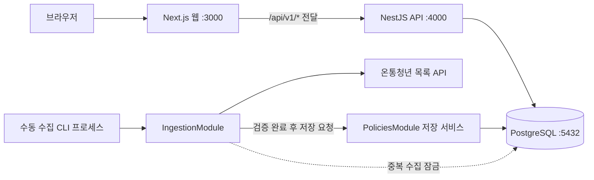
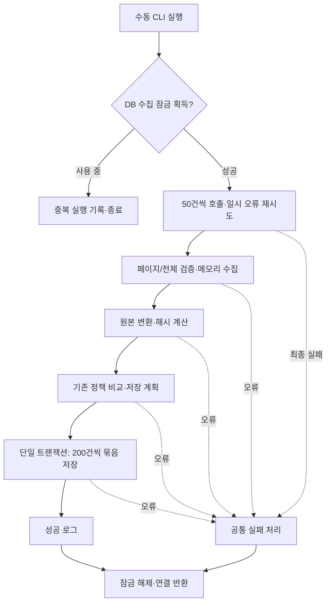

# 청년꿀통(youth-kkultong) ARCHITECTURE v0.3

기준: PRD v0.8 (2026-10-16) · 상태: 구현 전 구조 설계

## 목차

1. [설계 목표](#1-설계-목표)
2. [기술 스택](#2-기술-스택)
3. [시스템 구성](#3-시스템-구성)
4. [서비스 내부 구조](#4-서비스-내부-구조)
5. [데이터 흐름](#5-데이터-흐름)
6. [저장소·디렉터리 구성](#6-저장소디렉터리-구성)
7. [실행·배포와 보안](#7-실행배포와-보안)
8. [검증 기준과 설계 결정](#8-검증-기준과-설계-결정)

## 1. 설계 목표

온통청년 정책을 안정적으로 수집·보관하고, 사용자가 입력한 조건에 따라 **명확한 부적합만 제외한 뒤 확인된 일치 점수로 정렬**한다.

- 처음에는 약 3,255건의 정책을 처리하는 **단일 API 서버**로 시작한다.
- 수집, DB 저장, 정책 조회, 자격 판단, 정렬을 역할별로 구분한다.
- 외부 API의 원본과 서비스용 데이터를 분리해 외부 응답 형식 변경에 대응한다.
- 이용자 조건은 요청 시에만 처리하고, DB에는 정책 데이터만 저장한다.

## 2. 기술 스택

| 구분 | 선택 | 용도 |
| --- | --- | --- |
| 언어·실행 | TypeScript(strict), Node.js 24 LTS | 웹·서버 공통 언어 |
| 프런트엔드 | Next.js (App Router), React | 정책 목록·필터·상세 UI |
| 백엔드 | NestJS (REST API) | 수집·정책 조회·매칭·정렬 |
| DB | PostgreSQL 17 | 정책 원본(JSONB)과 조회용 데이터 저장 |
| DB 접근 | TypeORM + Migration(스키마 변경 파일) | 엔티티·조회·DB 변경 이력 |
| 데이터 검증 | Zod | API 요청 및 공통 타입 검증 |
| 실행 | Docker Compose | web·api·db 컨테이너 관리 |
| 테스트 | Jest, Supertest | 규칙 단위 테스트 및 API 통합 테스트 |
| 로그 | NestJS Logger + 수집 전용 파일 로그 | 서버 로그는 표준 출력, 수집 결과는 파일로 기록 |

버전의 세부 패치 번호는 구현 시점에 호환성을 확인하고 잠금 파일(`package-lock.json`)과 Docker 이미지 태그로 고정한다. 패키지 관리는 **npm workspaces(작업공간)** 를 사용한다.

## 3. 시스템 구성



- `web`: 목록·상세 페이지, 입력 상태, 카드와 일치 태그 표시.
- `api`: 정책 조회 API, 신청 상태 계산, 조건 판정 및 점수 계산. 수동 수집 CLI와 NestJS 소스·이미지를 공유한다.
- `db`: 정책·공식 지역 코드 보관 및 수집 중복 실행 잠금.
- **CLI 실행:** 독립 프로세스에서 NestJS 애플리케이션 컨텍스트를 열고 수집 서비스를 호출한다. 별도 상시 Worker 컨테이너는 필요하지 않다.
- 브라우저의 `/api/v1/*` 요청은 Next.js의 `rewrites(경로 전달)`로 내부 `api:4000`에 연결한다. 운영 환경에서도 웹과 API에 동일한 접근 경로를 제공한다.

### 책임 경계

| 위치 | 책임 |
| --- | --- |
| 웹 | 필터·정렬 입력, 페이지 이동, 카드 렌더링, 브라우저 세션 상태 |
| API 컨트롤러 | 요청값 검증, 응답 형식과 오류 코드 |
| 정책 조회 서비스 | 정책 후보 조회 및 최종 목록 조합 |
| 매칭·점수 함수 | 자격 조건 비교, 보수적 제외, 일치 태그·점수 산정 |
| 신청 상태 함수 | 한국 날짜 기준 신청 상태 계산 |
| 수집 서비스 | API 페이지 조회·검증·변환, 일시 오류 재시도, 중복 실행 잠금, 정책 저장 요청 및 실패 기록 |
| 정책 저장 서비스 | 해시 비교·신규/변경 판정, 묶음 쓰기와 전체 트랜잭션 처리 |
| 도메인 Repository(DB 접근) | 소속 모듈의 엔티티 조회·저장. 저장 서비스가 넘긴 트랜잭션 관리자 사용 |

## 4. 서비스 내부 구조

### 4.1 NestJS 모듈

| 모듈 | 핵심 역할 |
| --- | --- |
| `PoliciesModule` | 정책 목록·상세 API, 분야 필터, 페이지네이션, 정책 저장 서비스와 `PolicyRepository` |
| `MatchingModule` | 나이·취업·학력 제외 판단, 지역 관련 점수, 맞춤 정렬 |
| `IngestionModule` | 온통청년 페이지 조회, 응답 검증·변환, 수집 잠금 및 저장 요청 |
| `MetaModule` | DB의 지역 목록(`RegionRepository`)·정책 분야 목록, 서버에 정의한 취업·학력 코드표 제공 |
| `DatabaseModule` | 공통 TypeORM 연결 설정·Migration·지역 시드 실행 기반 |

`IngestionModule`은 `PoliciesModule`이 외부로 제공하는 정책 저장 서비스를 호출한다. 정책의 저장·수정은 `PoliciesModule`에서 한곳으로 모으고, 각 Repository는 소속 도메인 모듈 안에서 관리한다. `MetaModule`의 분야 목록은 `PoliciesModule`의 조회 서비스를 이용한다. `DatabaseModule`은 DB 연결과 Migration 중심으로 유지한다.

`MatchingModule`의 핵심은 **순수 함수**로 작성한다. 입력은 정규화된 정책과 사용자 조건, 출력은 제외 여부·점수·일치/확인 태그다. DB나 HTTP 호출 없이 테스트할 수 있어야 한다.

### 4.2 Next.js 페이지

| 경로 | 화면 |
| --- | --- |
| `/` | `/policies`로 이동(리다이렉트) |
| `/policies` | 정책 목록, 분야·조건 입력, 정렬, 마감 포함, 페이지네이션 |
| `/policies/[id]` | 정책 상세, 지원 내용·기간·자격 조건, 신청·참고 링크 |

필터 UI는 Client Component(브라우저 동작 컴포넌트)로 구현한다. 공개 탐색 조건(분야·마감 포함·정렬·페이지)과 사용자 조건을 구분하며, 사용자 조건은 `sessionStorage(탭 세션 저장소)`에 보관해 새로고침에도 유지한다. API 검색 요청은 `POST` 본문으로 전달하고 서버에는 저장하지 않는다.

## 5. 데이터 흐름

### 5.1 수집 → 정책 저장



1. **잠금:** CLI 시작 시 PostgreSQL Advisory Lock(동시 실행 방지 잠금)을 획득하고, 전용 `QueryRunner`(DB 연결 관리 객체)로 수집 종료까지 유지한다. 이미 실행 중이면 중복 실행으로 기록한다.
2. **수집·검증:** API에서 50건씩 순차 조회하고 요청 사이 3초 대기한다. 일시적인 네트워크 장애, 타임아웃, HTTP 429·5xx만 요청 단위 최대 3회(최초 요청 포함) 시도한다. 각 페이지와 전체 정책의 건수·식별자를 검증하고 약 3천 건을 메모리에 모은다.
3. **변환·저장:** 전부 검증된 후 원본을 내부 데이터로 변환하고, 조회수(`inqCnt`)를 뺀 내용 해시로 `NEW / CHANGED / UNCHANGED`를 분류한다. **200건씩 묶음 INSERT/UPDATE(일괄 추가·갱신)** 하되 **트랜잭션은 전체 수집분에 하나만** 사용한다. 어느 묶음에서 실패해도 전부 롤백한다. 조회수는 재수집 시 최신 값으로 갱신한다.
4. **공통 실패 처리:** API 호출, 검증, 변환, 해시 비교, DB 읽기·쓰기, 로그 처리 중 발생한 오류는 단계·원인을 기록한다. 트랜잭션 중이라면 롤백하고 수집을 실패로 마친다. 검증·데이터 형식 오류는 재시도하지 않으며, 복구 가능한 DB 트랜잭션 충돌만 제한적으로 재시도한다(상세 기준은 SPEC 5장).
5. **자원 정리:** 정상 종료·최종 실패 모두 `finally`에서 잠금을 해제하고 연결을 반환한다. 파일 로그가 실패하면 NestJS 기본 로그에 남기는 것을 시도하며, 로그 실패가 잠금 해제를 방해하지 않게 한다. 프로세스가 강제 종료되거나 DB 연결이 끊기면 DB가 세션 잠금을 해제한다. API 호출 중에는 DB 트랜잭션을 열지 않는다.
6. **데이터 보관:** 원본 객체는 `JSONB`에 저장하고 목록·매칭용 컬럼을 분리한다. 수집 실패 시 기존에 확정 저장된 정책은 유지한다.

### 5.2 탐색 → 맞춤 목록


현재 규모에서는 API가 **목록 판단에 필요한 경량 컬럼만 조회**하고, 전체 후보에 상태 계산·매칭·정렬을 적용한 다음 페이지를 나눈다. 원본 JSON과 긴 상세 본문은 상세 조회에서 가져온다. 데이터 규모가 크게 증가하면 해당 계산 중 병목 구간만 DB 조회로 이동한다.

### 5.3 DB의 책임

MVP1의 데이터는 `policies(정책)`와 `regions(공식 지역 코드)` 2개 테이블을 중심으로 관리한다. 정확한 컬럼·인덱스·제약조건은 `docs/mvp-1/SPEC.md`에 정의한다.

- 정책 유일성: `(source, external_id)` 복합 UNIQUE(중복 금지).
- 공식 지역 코드는 현행·폐지 구분과 상위 지역 관계를 저장한다.
- 수집 실행 이력은 파일 로그로 관리한다. 컨테이너 실행 시 로그 디렉터리를 볼륨으로 연결해 재시작해도 유지한다.
- PostgreSQL Advisory Lock은 **동시 실행 차단용**이며 정책 상태 컬럼이나 별도 수집 상태 테이블을 대체한다. 상태 기록은 파일 로그로 구분한다.

## 6. 저장소·디렉터리 구성

```text
youth-kkultong/
├── apps/
│   ├── web/                 # Next.js
│   │   ├── app/
│   │   │   ├── page.tsx               # /policies로 이동
│   │   │   └── policies/
│   │   │       ├── page.tsx           # 정책 목록
│   │   │       └── [id]/page.tsx      # 정책 상세
│   │   └── features/policies/
│   └── api/                 # NestJS
│       ├── src/
│       │   ├── modules/
│       │   │   ├── policies/
│       │   │   │   ├── policies.module.ts
│       │   │   │   ├── entities/policy.entity.ts
│       │   │   │   ├── repositories/policy.repository.ts
│       │   │   │   └── services/policies-write.service.ts
│       │   │   ├── matching/
│       │   │   ├── ingestion/         # API 호출·변환·잠금·수집 명령
│       │   │   │   ├── ingestion.module.ts
│       │   │   │   ├── services/      # 수집 실행·중복 실행 잠금·결과 로그
│       │   │   │   └── youth-center/  # 온통청년 API 호출·응답 검증·변환·해시
│       │   │   └── meta/
│       │   │       ├── meta.module.ts
│       │   │       ├── eligibility-codes.ts
│       │   │       ├── controllers/meta.controller.ts
│       │   │       ├── entities/region.entity.ts
│       │   │       └── repositories/region.repository.ts
│       │   ├── database/              # DB 연결·마이그레이션·시드
│       │   └── common/                # 오류·설정·로깅
│       └── scripts/import-policies.ts
├── packages/
│   └── shared/              # API 계약·Zod 스키마·공용 타입
├── docs/
│   ├── AGENT_RULES.md
│   ├── PRD.md
│   ├── ARCHITECTURE.md
│   └── mvp-1/
│       ├── PLAN.md
│       ├── SPEC.md
│       └── SUMMARY.md
├── compose.yaml
├── .env.example
└── package.json
```

**공용 타입에는 API 요청·응답 형식만 둔다.** DB 엔티티는 소속 NestJS 모듈에 둔다. 취업·학력 코드의 실제 값·표시명은 서버에서 관리하고 `MetaModule`을 통해 제공한다. 공용 인터페이스는 이 메타 API의 응답 형식을 정의한다.

`meta`·`policies`의 Controller·Repository·Service는 소속 모듈 안의 `controllers/`·`repositories/`·`services/`에 역할별로 둔다. 모듈 등록 파일은 모듈 루트에 유지하고, 해당 역할의 파일이 아직 없으면 빈 폴더는 만들지 않는다.

## 7. 실행·배포와 보안

| 항목 | 기준 |
| --- | --- |
| 컨테이너 | `web:3000`, `api:4000`, `db:5432` (DB는 내부 네트워크) |
| 실행 설정 | `DATABASE_URL`, `YOUTH_CENTER_API_KEY`, `YOUTH_CENTER_PAGE_SIZE=50`, `YOUTH_CENTER_REQUEST_DELAY_MS=3000`, `YOUTH_CENTER_MAX_ATTEMPTS=3`, `POLICY_IMPORT_BATCH_SIZE=200`, `TZ=Asia/Seoul` |
| DB 초기화 | 명시적 TypeORM Migration 실행 → 공식 지역 코드 시드 |
| 정책 수집 | 같은 API 이미지의 독립 CLI 프로세스에서 `npm run import:policies` 실행. PostgreSQL Advisory Lock으로 중복 실행 차단 |
| 로그 | 서버 로그는 표준 출력, 수집 결과는 `/app/logs/`에 기록·볼륨 보관. API 키·사용자 조건 원문은 기록하지 않음 |
| 외부 링크 | `https://`/`http://` URL만 렌더링, 새 탭 이동 시 `noopener noreferrer` 적용 |
| 장애 대응 | 수집 실패 시 기존 DB 보존, 읽기 API는 기존 정상 정책 제공 |
| 백업 | PostgreSQL 정기 백업 경로와 복원 절차를 배포 환경에 포함 |

환경변수의 비밀값은 `.env` 또는 운영 비밀 저장소로 전달하며 Git에 커밋하지 않는다. TypeORM의 `synchronize`는 `false`로 고정하고 스키마 변경은 Migration으로 관리한다.

로컬 DBeaver 검수에는 `docker compose -f compose.yaml -f compose.local.yaml up -d db`로 기존 DB의 `5432` 포트를 호스트 `127.0.0.1:5433`에 연결한다. 내부 전용 네트워크만 연결된 DB는 Docker Desktop에서 포트가 공개되지 않아, 이 로컬 설정에서만 DB 전용 `db_local` 네트워크를 추가한다. 공유 `app` 네트워크에는 DB를 연결하지 않으며, 같은 DB 볼륨과 `database` 네트워크를 유지한다. 기본 Compose 구성은 변경하지 않는다. DBeaver에는 호스트 `127.0.0.1`, 포트 `5433`, DB·사용자 `youth_kkultong`, `.env`의 `POSTGRES_PASSWORD`를 입력한다.

## 8. 검증 기준과 설계 결정

- 정책 재수집 후 `(source, external_id)` 중복이 0건이어야 한다.
- 호출 재시도가 성공하면 수집을 이어가고, 최종 실패·변환 오류·해시 오류·묶음 저장 오류 시에는 기존 정책 데이터가 바뀌지 않아야 한다.
- 동일 출처 수집 CLI를 동시에 실행하면 하나만 잠금을 획득한다. 정상·오류 종료 모두 잠금이 풀려 다음 실행이 가능하며, 파일 로그 실패도 잠금 반환을 막지 않아야 한다.
- `/` 접속 시 `/policies`로 이동하며 목록·상세 주소가 각각 정상 동작해야 한다.
- 상태·매칭·점수 함수가 고정 테스트 입력에서 일관된 결과를 반환해야 한다.
- 조회 결과는 **필터 → 제외 → 점수 → 정렬 → 페이지네이션** 순서를 지켜야 한다.
- 사용자 조건을 포함한 요청 본문을 파일 로그와 DB에 남기지 않아야 한다.

**설계 결정 요약:** 독립 CLI 수집, 모듈별 Repository(DB 접근 계층), PostgreSQL 잠금, 일시 오류 재시도, 전체 검증 후 단일 트랜잭션·묶음 저장, 순수 함수 매칭을 MVP1 구조 기준으로 사용한다.
