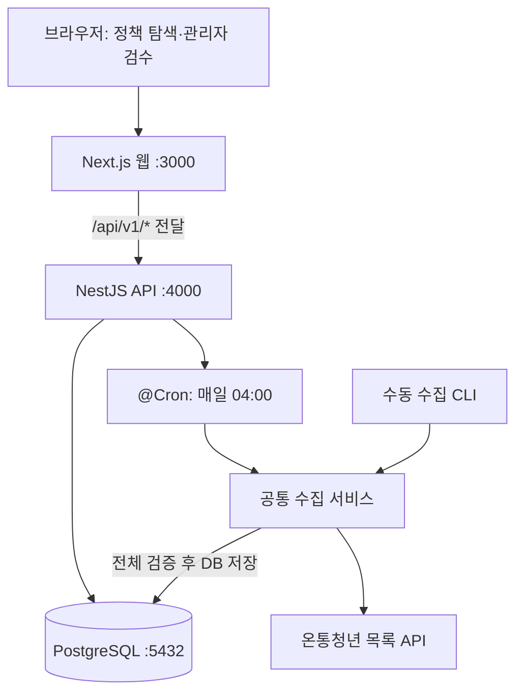
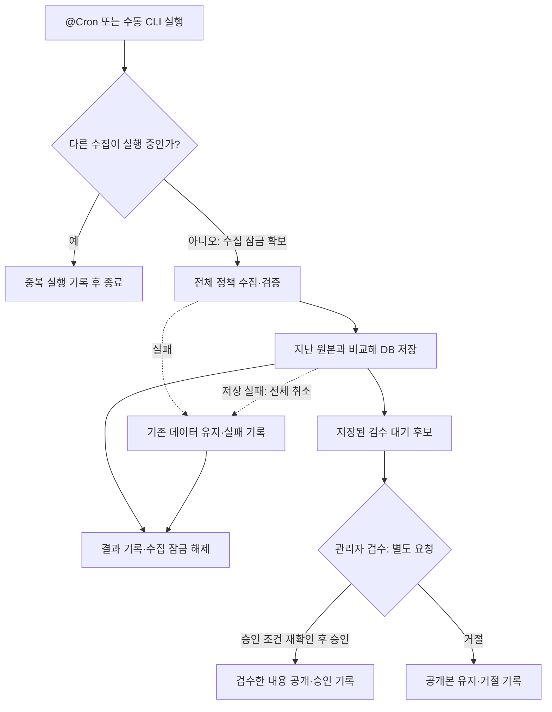

# 청년꿀통(youth-kkultong) ARCHITECTURE v0.7

기준: PRD v0.12 (2026-10-28) · 상태: MVP1 실제 구조 유지 · MVP2 설계 확정안

이 문서는 실행 구조·모듈 경계·데이터 흐름을 정의한다. 제품 정책은 PRD, 컬럼·API·상태 전이·예외·테스트 기준은 `mvp-2/SPEC.md`를 따른다. MVP1 구현 기록은 `mvp-1/SUMMARY.md`이며 MVP2 추가 구조는 아직 구현 전이다.

## 목차

1. [설계 목표](#1-설계-목표)
2. [기술 스택](#2-기술-스택)
3. [시스템 구성](#3-시스템-구성)
4. [서비스 내부 구조](#4-서비스-내부-구조)
5. [데이터 흐름](#5-데이터-흐름)
6. [저장소·디렉터리 구성](#6-저장소디렉터리-구성)
7. [실행·배포와 보안](#7-실행배포와-보안)
8. [검증 기준과 설계 결정](#8-검증-기준과-설계-결정)

## 1. 설계 목표

온통청년 정책을 안정적으로 수집·보관하고, 사용자가 입력한 조건에 따라 **명확한 부적합만 제외한 뒤 지역 관련 여부와 확인된 일치 점수로 맞춤 정렬**한다.

- MVP1에서 검증한 수천 건 규모의 **단일 API 서버** 구조를 유지한다.
- 수집, DB 저장, 정책 조회, 자격 판단, 정렬을 역할별로 구분한다.
- 최신 수집 원본·검수 후보·공개 정책을 분리하고 승인된 내용만 사용자에게 제공한다.
- 기존 UUID·공개 API·조회 계산을 유지하면서 자동 수집과 관리자 웹 검수를 추가한다.
- 이용자 조건은 요청 시에만 처리하고, DB에는 정책·검수 운영 데이터와 공식 지역 코드를 저장한다.

## 2. 기술 스택

| 구분 | 선택 | 용도 |
| --- | --- | --- |
| 언어·실행 | TypeScript(strict), Node.js 24 LTS | 웹·서버 공통 언어 |
| 프런트엔드 | Next.js (App Router), React | 정책 목록·필터·상세 및 관리자 검수 UI |
| 백엔드 | NestJS (REST API) | 수집·정책 조회·매칭·정렬·검수·관리자 인증 |
| DB | PostgreSQL 17 | 수집 원본(JSONB)·검수 후보/이력·공개 정책·공식 지역 코드 |
| DB 접근 | TypeORM + Migration(스키마 변경 파일) | 엔티티·조회·DB 변경 이력 |
| 데이터 검증 | Zod | API 요청 및 공통 타입 검증 |
| 실행 | Docker Compose + `@nestjs/schedule` | web·api·db 관리, NestJS `@Cron` 자동 수집 |
| 테스트 | Jest, Supertest | 규칙 단위 테스트 및 API 통합 테스트 |
| 로그 | NestJS Logger + 수집 전용 파일 로그 | 서버 로그는 표준 출력, 수집 결과는 파일로 기록 |

버전의 세부 패치 번호는 구현 시점에 호환성을 확인하고 잠금 파일(`package-lock.json`)과 Docker 이미지 태그로 고정한다. 패키지 관리는 **npm workspaces(작업공간)** 를 사용한다.

## 3. 시스템 구성

- `web`: 기존 목록·상세·입력 상태·태그 표시와 관리자 검수 화면을 제공한다.
- `api`: 기존 공개 API와 관리자 인증·검수 API를 제공한다. CLI는 같은 NestJS 모듈·소스·이미지를 재사용한다.
- `db`: 수집 원본, 검수 후보와 이력, 공개 정책, 공식 지역 코드 및 수집 잠금을 관리한다.
- **자동·수동 실행:** API 프로세스의 `@Cron`이 공통 수집 서비스를 호출한다. 수동 CLI는 독립 프로세스로 같은 서비스를 호출하고 종료한다. 자동 수집에 자식 프로세스나 별도 Worker는 사용하지 않는다.
- `ScheduleModule.forRoot()`와 스케줄러 제공자는 HTTP 실행 구성에만 등록한다. 수집·Migration·시드 CLI에는 스케줄러를 등록하지 않는다. 단일 API 인스턴스를 기준으로 하며 자동·수동 수집은 같은 DB 잠금을 사용한다.
- 브라우저의 `/api/v1/*` 요청은 기존 Next.js `rewrites(경로 전달)`로 내부 `api:4000`에 연결한다. 관리자 요청도 같은 경로를 사용하며, 권한 확인은 API에서 수행한다.

컨트롤러는 요청·응답과 접근 검사를, 서비스는 업무 흐름을, Repository(저장소 계층)는 DB 접근을 맡는다. 매칭·신청 상태 계산은 DB 호출 없는 순수 함수로 유지한다.

## 4. 서비스 내부 구조

### 4.1 NestJS 모듈

| 모듈 | 핵심 역할 |
| --- | --- |
| `PoliciesModule` | 기존 공개 목록·상세·분야 조회, 공개 저장 서비스, 수집 원본·검수 후보의 저장/조회 및 검수 서비스 |
| 매칭 순수 함수 (`modules/matching/`) | 나이·취업·학력 제외 판단, 지역 관련 점수, 맞춤 정렬. 별도 NestJS 모듈 클래스 없이 정책 서비스에서 사용 |
| `IngestionModule` | 온통청년 공통 수집 서비스·HTTP 전용 스케줄러·수동 CLI·검증·변환·잠금·로그, 수집분 저장 요청 |
| `AdminModule` (MVP2) | 최소 관리자 인증·권한 검증, 보호된 검수·이력·누락 조회 API. `PoliciesModule`의 업무 서비스 호출 |
| `MetaModule` | DB의 지역 목록(`RegionRepository`)·정책 분야 목록, 서버에 정의한 취업·학력 코드표 제공 |
| `DatabaseModule` | 공통 TypeORM 연결 설정·Migration·지역 시드 실행 기반 |

`IngestionModule`과 `AdminModule`은 각각 `PoliciesModule`의 저장·검수 서비스를 호출한다. 정책 모듈 안에서 **원본 저장·검수·공개 쓰기**를 역할별 서비스로 나누고 관련 엔티티·Repository를 관리한다. 관리자 컨트롤러에서 직접 DB를 바꾸지 않으며, 수집과 관리자 모듈은 서로 의존하지 않는다.

`MetaModule`의 분야 목록은 `PoliciesModule`이 내보내는 `PolicyRepository`를 이용한다. 정책 검색 서비스는 `MetaModule`이 내보내는 `RegionRepository`로 현행 코드와 부모 관계를 한 번 조회해 요청 검증·지역 판정에 재사용한다. 두 모듈의 상호 참조는 NestJS `forwardRef`(지연 참조)로 연결하며 Repository를 중복 등록하지 않는다. `DatabaseModule`은 DB 연결과 Migration 중심으로 유지한다.

매칭 함수는 정규화된 정책과 사용자 조건을 받아 제외 여부·점수·태그를 반환한다.

### 4.2 Next.js 페이지

| 경로 | 화면 |
| --- | --- |
| `/` | `/policies`로 이동(리다이렉트) |
| `/policies` | 정책 목록, 분야·조건 입력, 정렬, 마감 포함, 페이지네이션 |
| `/policies/[id]` | 정책 상세, 지원 내용·기간·자격 조건, 신청·참고 링크 |
| 관리자 전용 영역 (MVP2) | 인증, 검수 대기 목록·상세·공개본/변경본 비교·승인/거절, 처리 이력·누락 정책 확인. 상세 경로는 MVP2 SPEC 8장에서 정의 |

필터는 Client Component(브라우저 동작 컴포넌트)로 구현하고, 탐색 조건은 `sessionStorage`(탭 세션 저장소)에 보관한다. 저장·복원 범위는 MVP1 SPEC 8.1절을 따른다. 사용자 조건은 검색 POST 본문으로만 보내고 서버에 저장하지 않는다. 관리자 인증은 HttpOnly 쿠키를 사용하며 화면 접근 제어와 별개로 API에서 권한을 검사한다. 관리자 상세 경로·화면 동작은 MVP2 SPEC 8장에 정의한다.

## 5. 데이터 흐름

### 5.1 수집 → 비교·검수 → 공개

1. **실행:** 자동 수집은 API의 `@Cron`, 수동 수집은 CLI가 같은 수집 서비스를 호출한다. PostgreSQL Advisory Lock은 같은 수집 작업이 동시에 실행되지 않도록 하는 잠금이며 DB 전체 잠금이 아니다.
2. **수집:** 전체 페이지를 메모리에 모아 검증·변환하고 내용 해시(내용 비교값)를 계산한다. API 호출 중에는 DB 트랜잭션을 열지 않는다.
3. **DB 저장:** 지난 원본과 비교해 최신 원본·누락 정보·검수 후보·공개 조회수를 함께 저장한다. 기존처럼 묶음 쿼리를 사용하되 전체 수집분을 하나의 트랜잭션으로 처리한다. **전부 성공하면 저장하고 하나라도 실패하면 전부 취소한다.**
4. **검수:** 관리자는 저장된 후보를 별도 요청으로 승인·거절한다. 후보와 최신 원본, 검수 당시와 현재 공개본을 재확인하고 승인 내용·이력을 한 트랜잭션으로 반영한다.
5. **동시 처리:** 수집 중복 잠금과 별개로 수집 저장·관리자 검수가 같은 정책 행의 잠금 규칙을 공유한다. 확인과 저장 사이에 다른 쓰기가 끼어들지 않게 하며 공개 조회는 계속 제공한다.
6. **종료:** 결과·오류를 기록하고 잠금·연결을 반환한다. DB 확정 후 로그 기록 실패는 저장 취소와 구분한다. 파일 로그 실패도 자원 정리를 막지 않아야 한다.

후보 중복·교체·과거 해시 복귀는 MVP2 SPEC 6장, 호출·누락·재시도·로그는 5장에 정의한다.

### 5.2 탐색 → 맞춤 목록

**검색 순서:** 후보 조회 → 한국 날짜 기준 신청 상태 → 분야·제목·마감 필터 → 부적합 제외·점수·태그 → 전체 정렬 → 페이지 분리.

공개 API는 **`policies`만을 정책 데이터 기준으로 사용**하며, 검수 대기·거절·최신 원본을 직접 조회해 섞지 않는다. 분야 메타 목록도 공개 정책에서 산출한다. 기존 `POST /api/v1/policies/search`, `GET /api/v1/policies/:id`, 메타·health API의 경로와 요청·응답 계약은 유지한다.

현재 규모에서는 API가 **목록 판단에 필요한 경량 컬럼만 조회**하고, 조회한 전체 후보에 상태 계산과 분야·제목·마감 필터를 적용한다. 제목 비교는 서버 JS 순수 함수가 담당하며, 이후 자격 매칭·정렬을 적용한 다음 페이지를 나눈다. 분야의 쉼표 분리·중복 제거는 shared 공용 순수 함수를 API 선택지·JS 필터·웹 표시·세션 복원에서 공유하며 DB 원문은 유지한다. 원본 JSON과 긴 상세 본문은 상세 조회에서 가져온다. 데이터 규모가 크게 증가하면 해당 계산 중 병목 구간만 DB 조회로 이동한다.

### 5.3 DB의 책임

MVP1의 `policies`·`regions`를 유지하고 `source_policies`·`policy_reviews`를 추가한다. 원본과 공개 정책은 출처 정책 하나당 각각 최대 한 행으로 대응하며, 식별에는 기존 `(source, external_id)`(출처·외부 ID)로 일관되게 대응한다. 상세 컬럼·관계 제약·인덱스는 MVP2 SPEC에서 정의한다.

| 테이블 | 책임과 관계 |
| --- | --- |
| `source_policies` | 정책별 최신 수집 원본·해시·수집 시각·누락 정보. 하나의 원본에 여러 검수 이력이 연결되고, 공개 정책은 미승인 신규라면 없을 수 있다. |
| `policy_reviews` | 해당 원본의 검수 변경본·공개 기준본 스냅샷, 대상 해시·`base_content_hash`, 검수 결과와 처리 이력. 최신 원본을 덮어써도 당시 내용은 보존한다. |
| `policies` | 승인된 공개 내용·해시·원본 스냅샷과 최신 조회수. 공개 후에는 동일 정책의 UUID를 계속 사용한다. |
| `regions` | 기존 공식 지역 코드, 현행·폐지 구분, 부모·자식 관계 유지. |

- 공개 `raw_json`·내용 해시는 승인된 내용이며 최신 조회수는 별도로 갱신한다. 미승인 원본으로 공개본을 덮어쓰지 않는다.
- 기존 공개 데이터를 초기 원본으로 복사하되 공개 UUID·내용은 유지한다. 대기 후보·가상의 승인 이력은 만들지 않는다. 이관과 실제 수집 시각을 구분하는 규칙은 SPEC 2.4절을 따른다.
- 수집 결과·실패 원인은 기존 파일 로그와 볼륨에, 검수 이력·누락 정보는 DB에 보관한다. 별도 수집 이력 테이블은 추가하지 않는다.

## 6. 저장소·디렉터리 구성

기존 모듈별 배치를 유지하고 아래 위치에 MVP2 기능을 추가한다. 상세 파일 분리는 PLAN에서 정한다.

| 위치 | 역할 |
| --- | --- |
| `apps/web/app/policies/` | 기존 정책 목록·상세·탐색 상태 |
| `apps/web/app/admin/` | 관리자 인증·검수·이력·누락 화면. 관련 컴포넌트는 기존 정책 화면처럼 같은 폴더에 배치 |
| `apps/api/src/modules/policies/` | 공개·원본·검수 엔티티와 Repository, 조회·저장·검수 서비스 |
| `apps/api/src/modules/ingestion/` | 공통 수집 서비스·스케줄러·수동 실행·API 호출·검증·변환·잠금·로그 |
| `apps/api/src/modules/admin/` | 인증·권한 검사·관리자 컨트롤러 |
| `apps/api/src/modules/matching/`, `meta/` | 기존 매칭·메타 정보 |
| `apps/api/src/database/`, `common/` | 연결·Migration·시드, 설정·오류·로깅 |
| `packages/shared/` | API 계약·Zod 스키마·공용 함수 |
| `docs/mvp-1/`, `docs/mvp-2/` | MVP별 SPEC·PLAN·구현 결과 |

**공용 타입에는 API 요청·응답 형식만 둔다.** DB 엔티티는 소속 NestJS 모듈에 둔다. 취업·학력 코드의 실제 값·표시명은 서버에서 관리하고 `MetaModule`을 통해 제공한다. 공용 인터페이스는 이 메타 API의 응답 형식을 정의한다.

`meta`·`policies`의 Controller·Repository·Service는 소속 모듈 안의 `controllers/`·`repositories/`·`services/`에 역할별로 둔다. 모듈 등록 파일은 모듈 루트에 유지하고, 해당 역할의 파일이 아직 없으면 빈 폴더는 만들지 않는다.

## 7. 실행·배포와 보안

| 항목 | 기준 |
| --- | --- |
| 컨테이너 | `web:3000`, `api:4000`, `db:5432` (DB는 내부 네트워크) |
| 실행 설정 | `DATABASE_URL`, `YOUTH_CENTER_API_KEY`, `YOUTH_CENTER_PAGE_SIZE=50`, `YOUTH_CENTER_REQUEST_DELAY_MS=3000`, `YOUTH_CENTER_MAX_ATTEMPTS=3`, `POLICY_IMPORT_BATCH_SIZE=200`, `TZ=Asia/Seoul`, `ADMIN_USERNAME`, `ADMIN_PASSWORD_HASH`, `ADMIN_AUTH_SECRET`, `ADMIN_WEB_ORIGIN`, `POLICY_SCHEDULE_ENABLED=false` |
| DB 초기화 | 명시적 TypeORM Migration 실행 → 공식 지역 코드 시드 |
| 정책 수집 | API의 `@Cron`이 수집 서비스를 직접 호출. 수동 CLI는 `npm run import:policies --workspace apps/api` 유지. 두 경로 모두 Advisory Lock 사용 |
| 자동 실행 운영 | `POLICY_SCHEDULE_ENABLED=true`인 API에만 스케줄러 등록. 매일 04:00·Asia/Seoul, 단일 API 인스턴스. 중지 중 실행은 자동 보충하지 않음. 설정·검증은 SPEC 5.1절 참조 |
| 관리자 인증 | 환경변수로 관리하는 단일 관리자 자격과 서버에서 서명·만료를 검증하는 `HttpOnly` 인증 쿠키를 사용. 관리자/일반 사용자 계정 테이블과 별도 세션 인프라는 추가하지 않음 |
| 관리자 요청 보호 | 모든 관리자 API에 서버 측 인증·권한 검증, 상태 변경 요청의 출처 검증·CSRF(위조 요청) 방어 적용. Secure는 관리자 출처에서 자동 결정하고 HTTPS=true, localhost/127.0.0.1 HTTP만 false. SameSite·인증 시도 제한 적용. 인증 계약·만료 기준은 MVP2 SPEC에서 정의 |
| 로그 | 서버 로그는 표준 출력, 수집 결과는 `/app/logs/`에 기록·볼륨 보관. API 키·사용자 조건 원문은 기록하지 않음 |
| 공개 API 보호 | 정확한 출처의 CORS, NestJS 내장 보안 헤더, JSON 본문 한도, 단일 프로세스 접속 주소별 호출 제한. 공개·관리자 한도는 분리하며 수치·프록시 공유 한계는 MVP2 SPEC 7.2 및 MVP1 SPEC 4.3 참조 |
| 외부 링크 | `https://`/`http://` URL만 렌더링, 새 탭 이동 시 `noopener noreferrer` 적용 |
| 장애 대응 | 수집 실패 시 기존 DB 보존, 읽기 API는 기존 정상 정책 제공 |
| 백업 | 호스트 `backups/`에 PostgreSQL custom dump·수집 로그 tar 보관. 초기 실행·재기동·별도 DB 복원 절차는 `mvp-1/OPERATIONS.md` 참조 |

관리자 요청은 기존 웹 프록시와 같은 출처로 처리하며, 익명 공개 API의 CORS·요청 계약을 불필요하게 바꾸지 않는다. 인증 쿠키와 관리자 비밀값은 URL·브라우저 저장소·로그에 기록하지 않는다. 환경변수의 비밀값은 `.env` 또는 운영 비밀 저장소로 전달하며 Git에 커밋하지 않는다. TypeORM의 `synchronize`는 `false`로 고정하고 스키마 변경은 Migration으로 관리한다.

로컬 DB 검수는 기존 `compose.local.yaml`의 `127.0.0.1:5433` 연결만 사용한다. 기본 DB 내부 네트워크·볼륨은 유지한다. 실행·접속·백업·복원 명령은 `mvp-1/OPERATIONS.md`를 따른다.

## 8. 검증 기준과 설계 결정

구조 검증의 핵심은 다음 네 가지다. 구체적인 테스트 입력과 기대 결과는 MVP2 SPEC 9장에 둔다.

- 기존 공개 UUID·API 계약·탐색 동작 유지
- 원본·검수·공개 데이터 분리 및 승인 시 재확인과 저장의 일괄 처리
- 수집·검수 동시 실행, 오류·로그 실패 이후에도 데이터와 잠금의 일관성 유지
- 관리자 API의 서버 권한 검사와 비밀값·사용자 조건 비노출

기존 CLI·PostgreSQL·단일 트랜잭션·순수 함수 매칭을 재사용하고 NestJS 스케줄러와 최소 관리자 인증을 추가한다. 후보·원본의 전체 버전 체인이나 별도 작업 인프라는 만들지 않는다.
